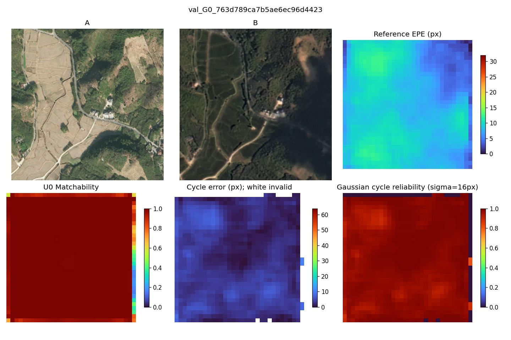
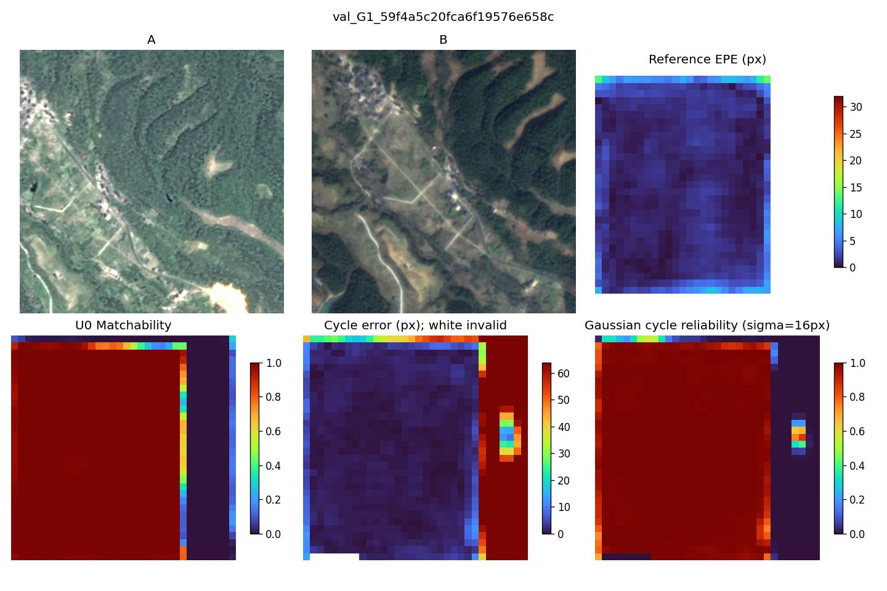
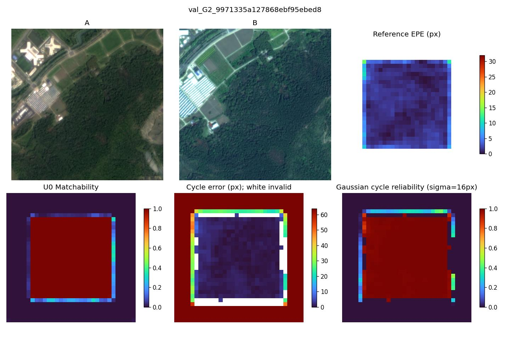
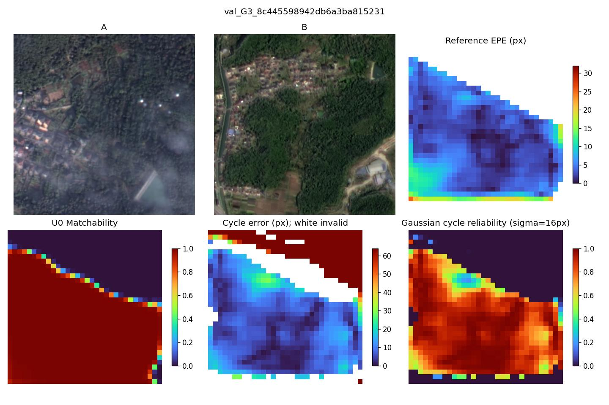

# 双向Flow0实验结果

[技术报告](REPORT.md)回答高置信错误识别、D8/D2和最终匹配收益、是否启动有效性训练三个问题。结论：保留U0与原下游，C未触发。

配对指标见paired.csv，G组/工作点统计见A.json、B.json，Matchability和Cycle误差分箱见reliability_bins.csv。原始每查询NPZ在服务器outputs/d16_bidirectional/{hangzhou,rgb}/。数据清单selection.json.gz仅包含开发数据，不含上轮封存测试。

示例按各G组清单首对固定，未按结果挑图。白色Cycle格子表示无法可靠插值；可靠性图中该位置为0，不代表已经证实无对应。

