# D16 对应判别三组实验结果（2026-10-22）

三组均完成30轮。实现版本：`eea188b`；分支：`codex/d16-correspondence-ablation`。

## 实验问题与配置

比较强化D16跨图候选分类能否改善Flow0。只训练预训练MVT和MatchEmbedding/Flow Head，冻结DINO；不执行或训练D8/D2/QRRU。

- A：共同的epoch 0预训练定位器。
- U：解冻MVT和Flow Head，使用原损失。
- B：同U初始化；保留原Geo，加入区域位置分类、Top16难负项和正查询可匹配性监督。
- C：同B，每4对正常样本额外输入一对整张B置零的样本，监督dustbin及不可匹配。U/B同样额外前后向，但该项乘零。
- 相同seed=42、254对训练/64对验证、固定30epoch、累积4、MVT LR=1e-5、头LR=5e-5、余弦退火到1e-6。
- 杭州数据只有AB及近似H和预处理掩码，没有人工对应点或真实稠密Flow；本次B/C没有把真实图像的掩码失败区域作为确定负查询。
- B/C相对U还改变了忽略及边缘标签规则，因此不是只改变分类权重的单变量对照。

## 第30轮统一比较

|组|EPE(px)↓|旧口径EPE↓|P@1↑|P@3↑|P@5↑|P@10↑|Rank@1↑|难负混淆↓|EPE>32px↓|
|---|---:|---:|---:|---:|---:|---:|---:|---:|---:|
|A初始|24.19|35.93|5.98%|36.78%|60.77%|79.51%|82.17%|17.83%|13.71%|
|U|11.39|17.68|27.37%|68.81%|81.51%|91.48%|88.09%|11.91%|4.63%|
|B|10.67|16.41|24.86%|66.19%|79.69%|90.46%|89.95%|10.05%|3.77%|
|C|10.50|16.25|25.24%|66.25%|79.64%|90.70%|90.17%|9.83%|3.26%|

EPE及比例按有效查询点加权；legacy_epe使用旧中心边界并对影像对求平均。两者不可混比。所有几何指标是相对近似H的参考一致性。Rank针对可信正候选区域，不是精确像素命中。

## 验证EPE最优检查点

|组|最优epoch|EPE|P@3|
|---|---:|---:|---:|
|U|29|11.351|68.96%|
|B|30|10.672|66.19%|
|C|27|10.453|64.67%|

## 最优检查点分组结果

|组|分组|EPE|P@3|Rank@1|EPE>32px|
|---|---|---:|---:|---:|---:|
|U|G0|2.245|74.69%|96.33%|0.00%|
|U|G1|2.745|73.89%|91.73%|0.12%|
|U|G2|7.715|73.20%|83.85%|6.64%|
|U|G3|47.771|43.79%|71.54%|17.31%|
|B|G0|1.797|90.01%|95.95%|0.00%|
|B|G1|4.008|51.40%|93.47%|0.68%|
|B|G2|5.076|66.56%|89.06%|2.89%|
|B|G3|46.941|33.89%|73.68%|17.28%|
|C|G0|1.748|88.99%|95.99%|0.00%|
|C|G1|4.134|49.30%|93.44%|0.72%|
|C|G2|4.190|63.75%|90.46%|0.68%|
|C|G3|46.884|34.02%|73.51%|17.27%|

## 目前结论及分析重点

1. 主要提升来自解冻预训练定位器微调；U已经大幅改善。B/C进一步提高排名、减少严重错误，但第30轮P@3低于U约2.6个百分点。
2. G3仍是主要难点。最佳检查点的G3 EPE约47px；B/C相对U改善有限。G1精细定位退步值得检查：排名提升并不保证位置解码准确。
3. C在固定4对全黑B探针上dustbin Top1达到100%，而U/B为0%。这只证明空图拒绝，不能代表预处理非重叠区域识别。
4. 单seed、64对验证，未进行独立测试集评测；不能把小差异视为稳定收益，也未证明下游QRRU或最终匹配收益。
5. 建议重点分析：正区域宽度/分类与Geo权重是否导致精定位取舍；G1/G3错误点的候选排序与解码误差；C是否应改为利用预处理确定的非重叠区域。

## 可直接读取的材料

- [全部逐轮及分组指标CSV](metrics.csv)
- [训练和验证样本清单](selection.json)（包含元数据，不含原始图像文件）
- [实验实现说明](../../mhinet/v2/d16_experiment/README.md)
- [损失实现](../../mhinet/v2/d16_experiment/supervision.py)
- [训练及评估实现](../../mhinet/v2/d16_experiment/train.py)

每组目录的epoch_NNN.json含每个验证影像对的指标、分组指标和空图探针。config.json为实际配置，status.json记录完成状态。未上传大型模型权重；权重保留在服务器原输出目录。

## 固定样本前中后诊断图

各组使用相同的G1/G2/G3首个验证样本，未按成功结果筛选。左图为A查询点EPE；中图在B上画H参考坐标→预测坐标的残差，1:1像素；右图展示该阶段最差查询的Top10候选。绿色在正区域内、红色在区域外、黄星为H参考、青叉为预测。影像对固定，但每阶段最差查询可能改变。对应JSON含最差8个查询的Top10概率及排名。

### U

**G1**

第0轮：[候选详情](U/G1_epoch_000.json)

第1轮：[候选详情](U/G1_epoch_001.json)
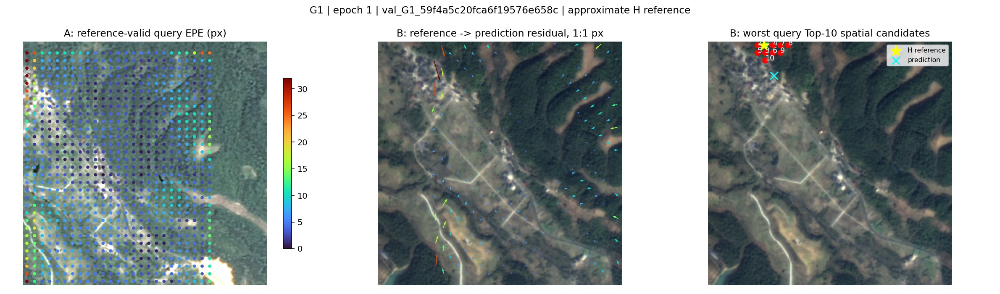

第15轮：[候选详情](U/G1_epoch_015.json)
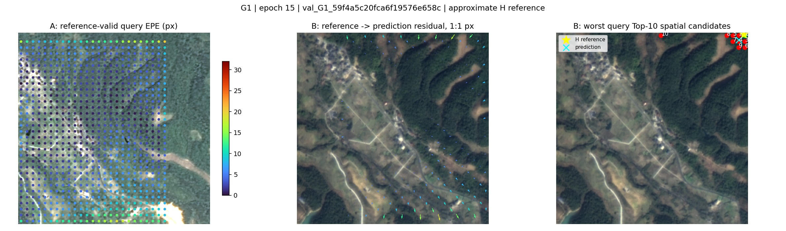

第30轮：[候选详情](U/G1_epoch_030.json)
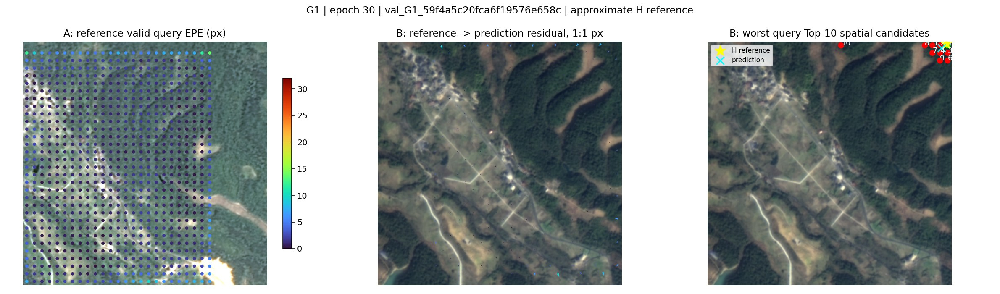

**G2**

第0轮：[候选详情](U/G2_epoch_000.json)

第1轮：[候选详情](U/G2_epoch_001.json)
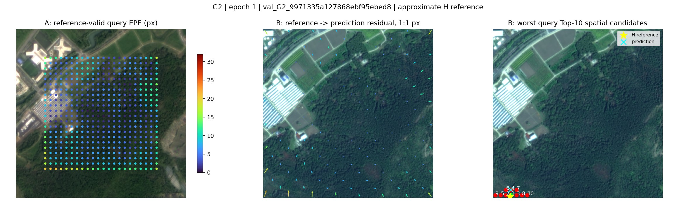

第15轮：[候选详情](U/G2_epoch_015.json)

第30轮：[候选详情](U/G2_epoch_030.json)

**G3**

第0轮：[候选详情](U/G3_epoch_000.json)
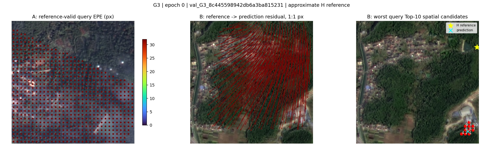

第1轮：[候选详情](U/G3_epoch_001.json)

第15轮：[候选详情](U/G3_epoch_015.json)
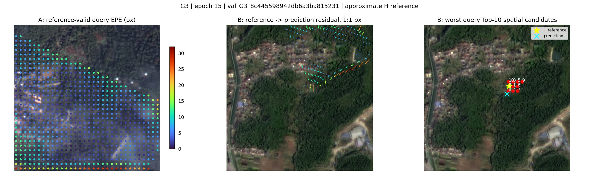

第30轮：[候选详情](U/G3_epoch_030.json)
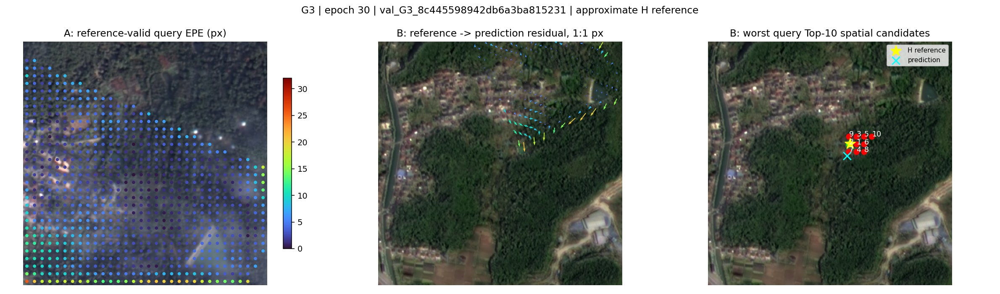

### B

**G1**

第0轮：[候选详情](B/G1_epoch_000.json)

第1轮：[候选详情](B/G1_epoch_001.json)
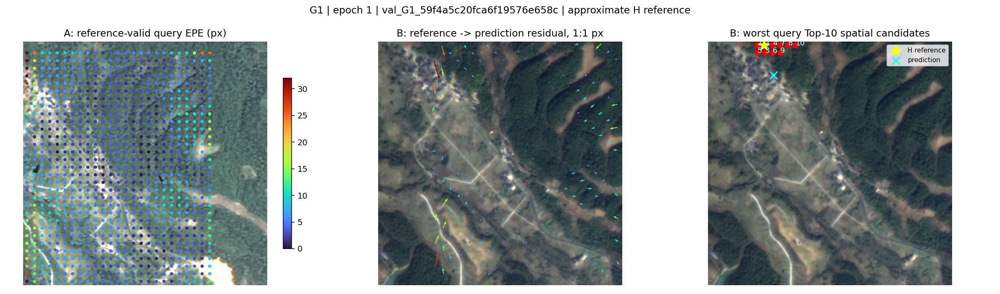

第15轮：[候选详情](B/G1_epoch_015.json)
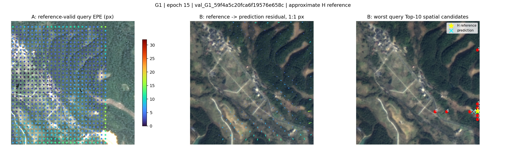

第30轮：[候选详情](B/G1_epoch_030.json)
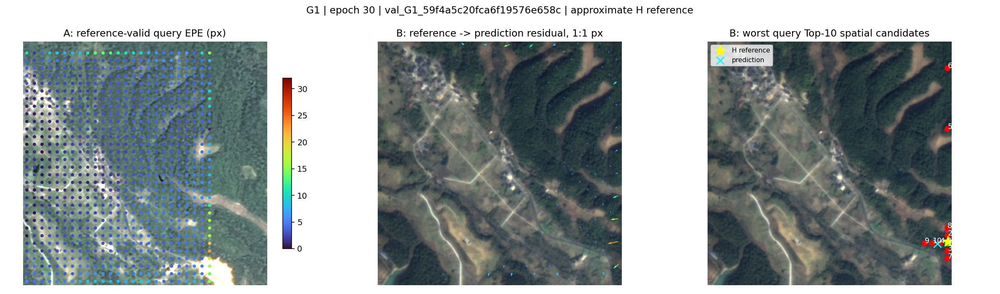

**G2**

第0轮：[候选详情](B/G2_epoch_000.json)
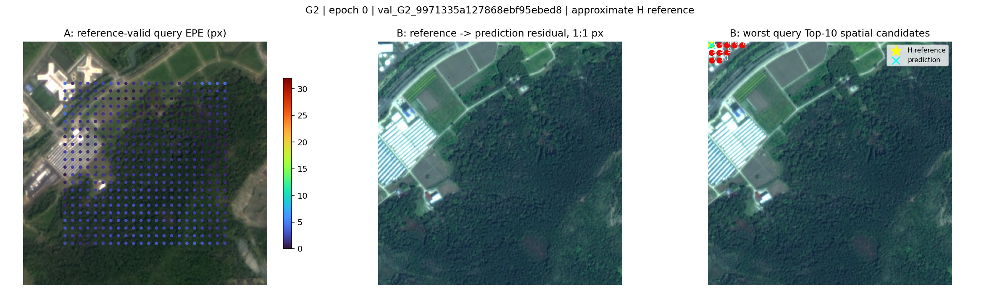

第1轮：[候选详情](B/G2_epoch_001.json)

第15轮：[候选详情](B/G2_epoch_015.json)

第30轮：[候选详情](B/G2_epoch_030.json)
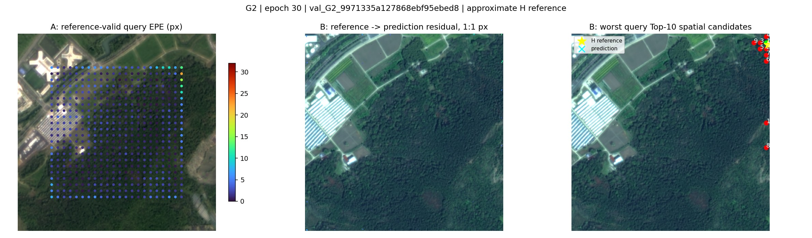

**G3**

第0轮：[候选详情](B/G3_epoch_000.json)

第1轮：[候选详情](B/G3_epoch_001.json)
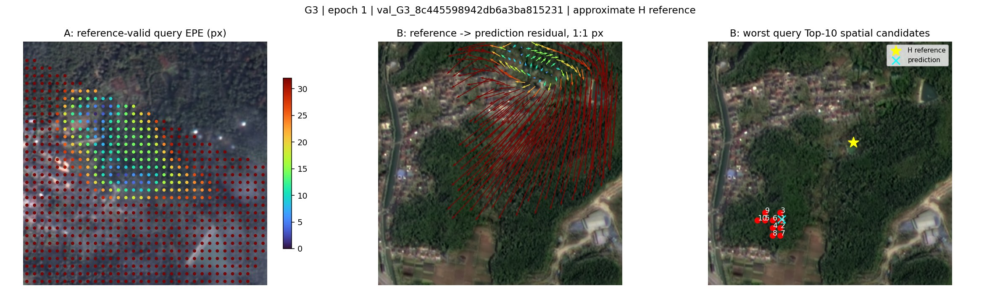

第15轮：[候选详情](B/G3_epoch_015.json)
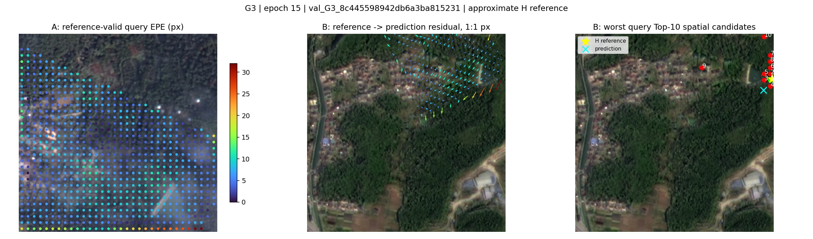

第30轮：[候选详情](B/G3_epoch_030.json)

### C

**G1**

第0轮：[候选详情](C/G1_epoch_000.json)
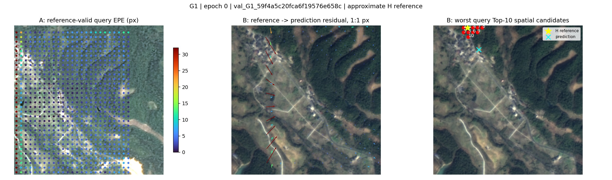

第1轮：[候选详情](C/G1_epoch_001.json)

第15轮：[候选详情](C/G1_epoch_015.json)
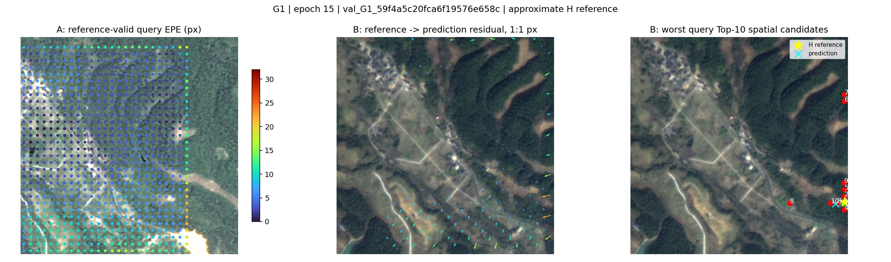

第30轮：[候选详情](C/G1_epoch_030.json)
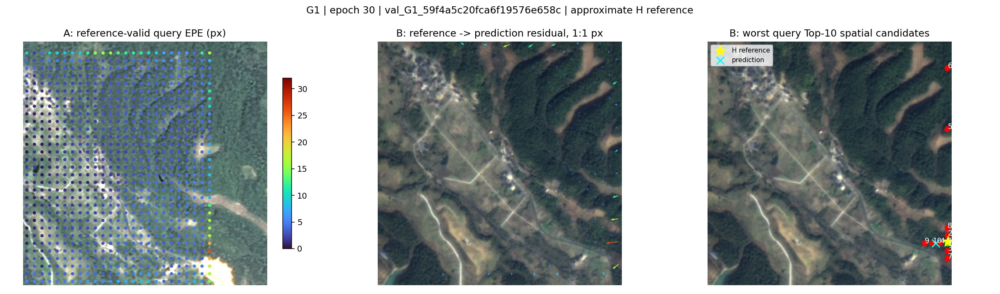

**G2**

第0轮：[候选详情](C/G2_epoch_000.json)

第1轮：[候选详情](C/G2_epoch_001.json)

第15轮：[候选详情](C/G2_epoch_015.json)
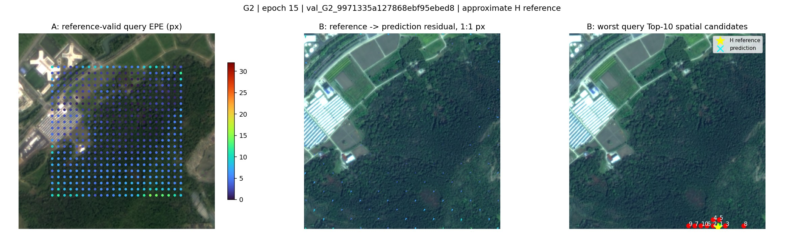

第30轮：[候选详情](C/G2_epoch_030.json)

**G3**

第0轮：[候选详情](C/G3_epoch_000.json)

第1轮：[候选详情](C/G3_epoch_001.json)

第15轮：[候选详情](C/G3_epoch_015.json)
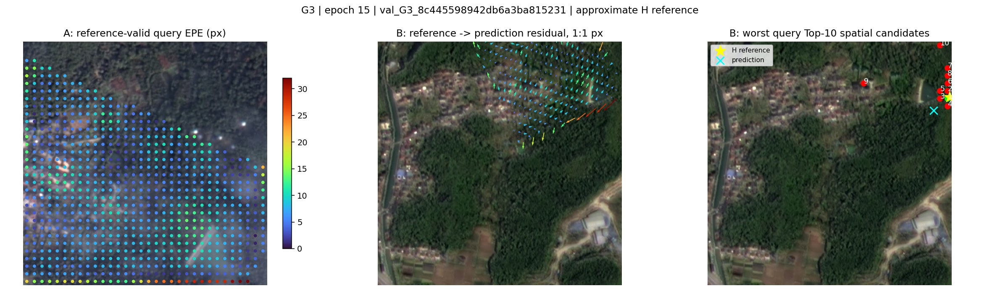

第30轮：[候选详情](C/G3_epoch_030.json)
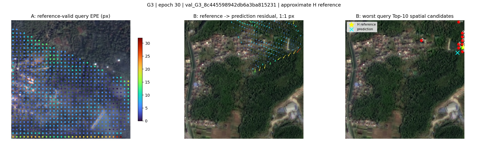

网页图使用质量88的JPEG；原始PNG保留在服务器实验输出目录。
