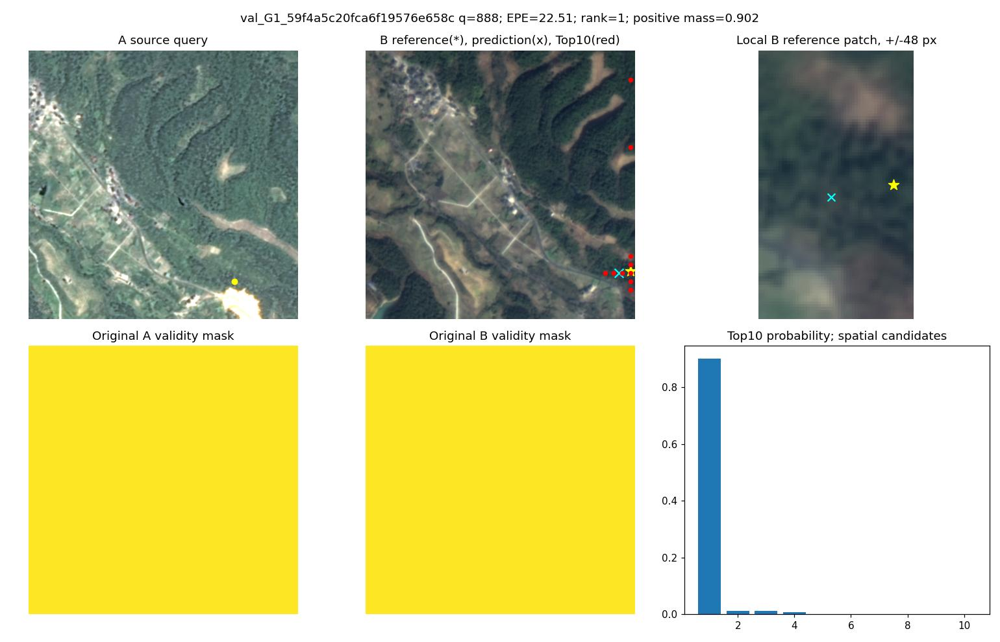
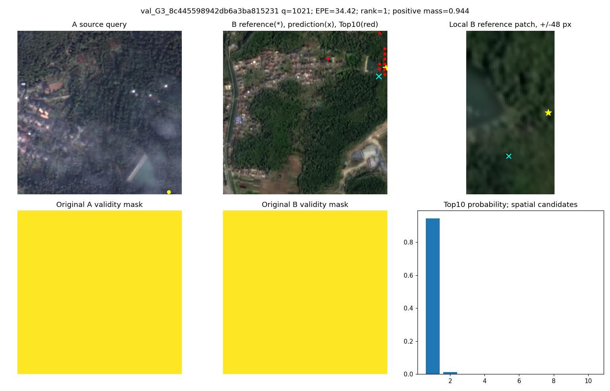
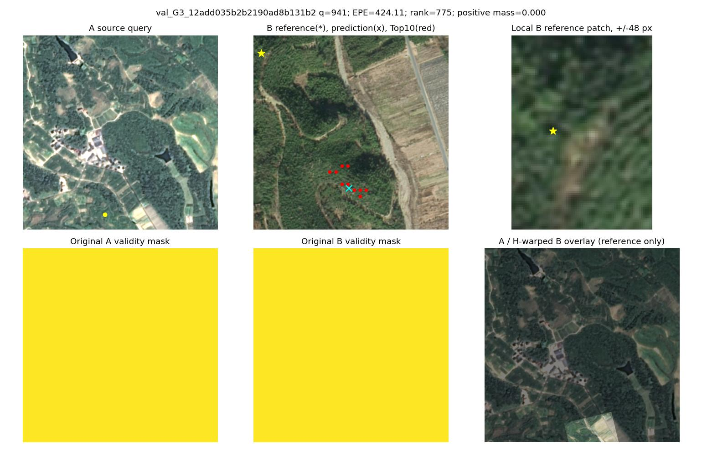
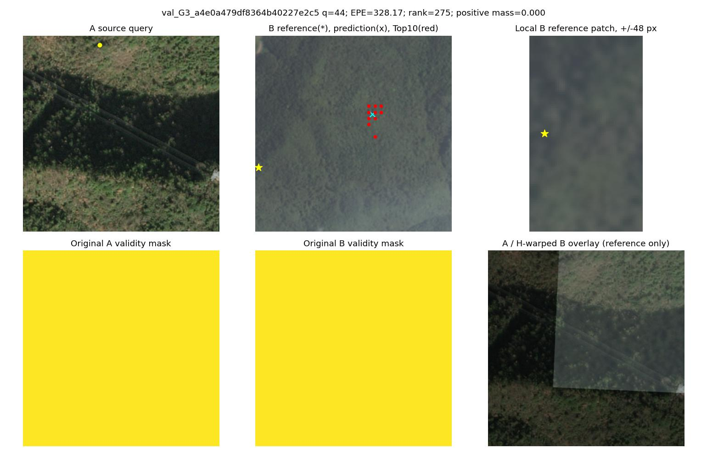
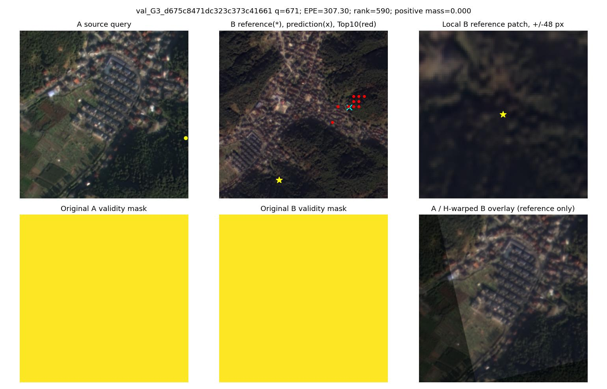

# 阶段一：第30轮D16解码诊断

仅诊断旧U/B/C，不重新训练。所有查询坐标相同；指标相对杭州近似H，不代表独立真实对应。

## 正区域排序与连续坐标

|模型|Rank=1查询数|Rank=1 EPE|Rank=1 P@3|Rank>1 EPE|理想概率整体EPE|理想概率整体P@3|
|---|---:|---:|---:|---:|---:|---:|
|U|39958|2.382|76.63%|77.996|6.829|14.94%|
|B|40802|2.878|72.79%|80.434|9.005|13.79%|
|C|40900|2.813|72.70%|81.016|8.888|14.04%|

三组各自Rank=1子集不同；以下进一步固定三组共同Rank=1的相同查询：

- U：39450点，EPE=2.324px，P@3=77.27%。
- B：39450点，EPE=2.604px，P@3=74.62%。
- C：39450点，EPE=2.592px，P@3=74.66%。

旧MatchEmbeddingDecoder由三个3×3卷积构成（含输出头），对源D16网格有7×7感受野，并使用零填充。单个查询的最高候选正确，不保证连续坐标正确；邻居概率分布和边界也参与输出。
理想概率诊断使用H坐标四邻域双线性分布，无效查询置dustbin，再进入原PE聚合及Decoder。它改变了整个概率场的分布及邻域输入，不能把结果全部归因于单点解码器，也不能据此将近似H当作精确真值。

## 方案引用的两个案例（B，第30轮）

- G1：`val_G1_59f4a5c20fca6f19576e658c`，查询888，正区域概率0.902166，排名1，EPE=22.513px，偏差(dx,dy)=[-22.075469970703125, 4.4190673828125]，H理想概率输入EPE=0.793px。

- G3：`val_G3_8c445598942db6a3ba815231`，查询1021，正区域概率0.943844，排名1，EPE=34.417px，偏差(dx,dy)=[-23.035400390625, 25.571197509765625]，H理想概率输入EPE=54.986px。

G1案例在理想概率场下明显改善；G3案例仍偏差很大。两者不能用同一种简单解释概括。暂不修改Decoder。

## 三个灾难性G3样本

三对均保留在正式统计中。排除它们仅用于定位长尾来源，不用于重新筛选训练集。
|模型|全量EPE|仅诊断排除3对EPE|全量P@3|排除后P@3|
|---|---:|---:|---:|---:|
|U|11.388|4.105|68.81%|70.78%|
|B|10.672|3.655|66.19%|68.07%|
|C|10.504|3.452|66.25%|68.14%|

### val_G3_12add035b2b2190ad8b131b2
B最差查询的正区域排名775，候选集中在错误位置；H叠图可见局部地貌结构，但该查询局部植被重复。支持“参考候选检索失败”的判断，不能独立证明H绝对准确。

[H、掩膜路径及尺度旋转原始元数据](B/val_G3_12add035b2b2190ad8b131b2_metadata.json)

### val_G3_a4e0a479df8364b40227e2c5
B最差查询排名275；B图明显低对比、林地纹理重复，局部对应的可观察性较弱。不能仅凭大EPE认定标签错误或解码器错误。

[H、掩膜路径及尺度旋转原始元数据](B/val_G3_a4e0a479df8364b40227e2c5_metadata.json)

### val_G3_d675c8471dc323c373c41661
B最差查询排名590；图中住宅区可辨认，但该查询落在重复植被区，Top10集中于另一区域。既有旋转/尺度变化，也有候选检索混淆。

[H、掩膜路径及尺度旋转原始元数据](B/val_G3_d675c8471dc323c373c41661_metadata.json)

所加载valid_A/B在这些图上为全有效；它们不等于真实重叠/遮挡标注。H投影的图内区域另由geometry.query计算。现有材料不能可靠将每个错误点划分成“真值错误”或“实际不可观察”，报告保留这种不确定性。

## 逐查询材料

各模型目录的NPZ保存全部1024查询：参考/预测/理想坐标、偏差向量、有效掩膜、排名、正区域概率质量、正候选最高概率、Top10坐标/概率、完整分布熵、边界距离、dustbin和matchability。summary.json含条件分箱及逐对统计；高置信错误的全部坐标保留在NPZ，每个有此类点的影像对保存最差点局部图；export_patches.py另输出所有高置信>8px查询的A/参考B/预测B局部图拼页，黑色补边表示裁剪超出图像。

本Git快照包含摘要和下方引用的重点图。全部逐查询NPZ、所有高置信错误局部图保留在服务器 outputs/d16_local_occlusion/diagnostics/。
