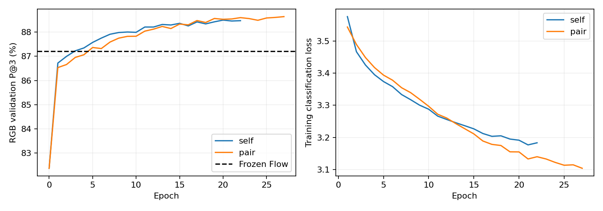

# D2 局部双图调制：RGB_512 小规模试验

模型与参数见 docs/mhi_v2/d2_local_modulation.md。训练254对、RGB验证64对选模型，RGB测试64对及杭州测试64对仅在训练结束后评估。Flow、D8及全部原特征网络冻结；仅新MLP学习。A/B均使用8×8上下文，A中心4×4查询与B8×8候选匹配，不执行QRRU或删点。三组共享FP32缓存，初始调制为恒等。

训练损失只有精确H四邻域软标签位置分类。验证最优允许选初始状态；结果好坏不影响实现验收。杭州只有近似H参考一致性。

新缓存入口与前轮基线在131072个验证查询上相差1个3px正确点（0.000763个百分点）；三组均以当前none为对照。恒等初始化与当前none的相似度/坐标完全一致。

|组|完成轮数|最佳轮次|RGB验证P@3|RGB测试P@3|杭州测试P@3|
|---|---:|---:|---:|---:|---:|
|none|0|0|82.38%|81.66%|58.07%|
|self|22|17|88.42%|87.69%|59.60%|
|pair|27|22|88.59%|87.92%|59.66%|

## RGB_512测试同点分析

|组|P@1|P@3|P@5|P@10|EPE(px)|正确区域Rank@1/5/10|改坏Flow|救回Flow|输出点数|
|---|---:|---:|---:|---:|---:|---|---:|---:|---:|
|none|22.83%|81.66%|95.98%|99.55%|2.011|80.08%/96.46%/98.93%|17823|12313|131072|
|self|35.32%|87.69%|96.74%|99.58%|1.658|87.41%/98.09%/99.47%|10814|13213|131072|
|pair|36.33%|87.92%|96.86%|99.59%|1.636|87.76%/98.14%/99.52%|10689|13385|131072|

同点直接Flow：P@3=85.86%，EPE=1.857px。Rank分母为窗口内有可见3px正确候选的查询；P@k分母为全部输出点，EPE仅参考可见点。

## 杭州测试同点分析

|组|P@1|P@3|P@5|P@10|EPE(px)|正确区域Rank@1/5/10|改坏Flow|救回Flow|输出点数|
|---|---:|---:|---:|---:|---:|---|---:|---:|---:|
|none|20.87%|58.07%|72.16%|86.95%|12.003|65.65%/80.99%/87.03%|9193|8088|131072|
|self|22.59%|59.60%|72.96%|87.30%|11.888|67.77%/82.49%/88.05%|6920|7831|131072|
|pair|22.68%|59.66%|72.99%|87.29%|11.888|67.92%/82.52%/88.19%|6569|7552|131072|

同点直接Flow：P@3=58.91%，EPE=12.069px。Rank分母为窗口内有可见3px正确候选的查询；P@k分母为全部输出点，EPE仅参考可见点。

## 结论边界

双图调制相对基线的RGB测试变化为 +6.26 个百分点，相对自调制为 +0.23 个百分点，相对同点Flow为 +2.06 个百分点。

小样本单seed不能证明普适效果。跨图条件价值应同时看pair相对self以及测试变化；只有相对Flow为正且净救回为正才通过“细化优于直接Flow”的目标。模型与训练实现已经独立运行，未将实验权重合入主线。

复现入口：mhinet/v2/d2_modulation。逐对计数见pairs.jsonl，配置/划分见summary.json与data.json，历史见history.json。best.pt/last.pt留在outputs/d2_modulation对应组目录，未加入Git。
