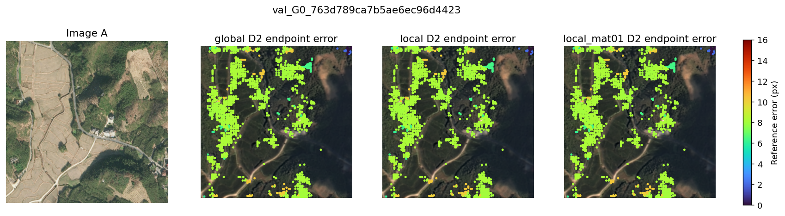
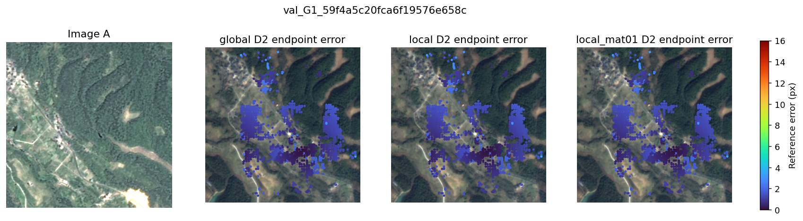
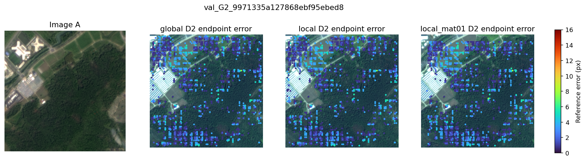
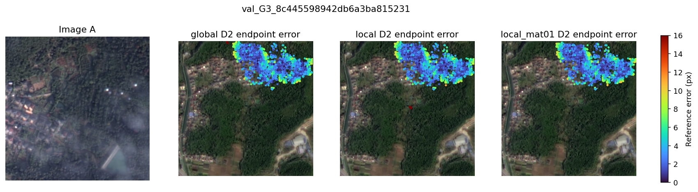
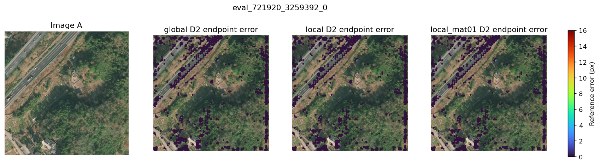
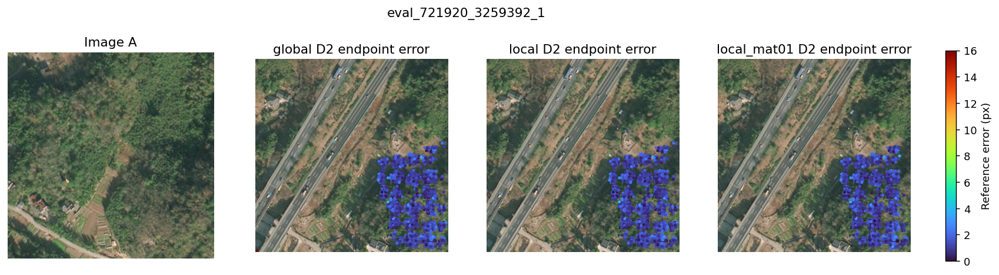

# Flow → D8 → D2 冻结能力测试

新分支：`codex/flow-d8-d2`。原 Flow 第30轮 + 旧杭州 D8/D2 第7轮；不训练、不运行 QRRU。这个组合未联合重训。
所有误差均为512原图像素。P@阈值的分母是全部输出，参考不可见位置计为不正确；EPE仅统计参考可见位置。按点汇总，正确点数为每对均值。
杭州64对使用近似H，仅衡量参考一致性；同源合成35对使用精确H。两者都是已使用的开发数据。
local 为 Flow ±4 D8格搜索，local_mat01 另过滤 Matchability<0.1。阈值未经部署校准。

## hangzhou：64 对

|路径/阶段|点数/对|可见EPE|P@1%|P@3%|P@5%|P@10%|正确点@3/对|
|---|---:|---:|---:|---:|---:|---:|---:|
|Flow0|1024.00|11.39|18.78|47.59|56.39|63.18|487.34|
|global/d8|2141.62|4.08|40.62|59.62|75.06|94.22|1276.80|
|global/d2|2023.34|7.87|30.32|64.05|77.38|90.25|1296.05|
|local/d8|2121.47|4.05|41.00|60.15|75.69|94.93|1276.08|
|local/d2|2019.92|8.14|30.38|64.16|77.50|90.34|1296.02|
|local_mat01/d8|2048.70|4.01|42.35|61.24|76.59|95.87|1254.58|
|local_mat01/d2|2013.30|8.08|30.40|64.31|77.70|90.64|1294.66|

同一批D2源点上的比较（仅保留Flow插值有效的位置；相同采样点与参考可见掩码）：

|路径|Flow EPE → D2 EPE|Flow P@3 → D2 P@3|配对点/全部D2点|搜索覆盖/全部可见D8查询|D8父窗口正确率|匹配耗时ms/对|
|---|---:|---:|---:|---:|---:|---:|
|global|7.73 → 7.88|69.28% → 64.20%|99.6%|100.0%|72.9%|15.6|
|local|8.10 → 8.14|69.25% → 64.16%|100.0%|95.1%|73.5%|15.5|
|local_mat01|8.01 → 8.08|69.77% → 64.31%|100.0%|92.1%|74.5%|14.6|

共享特征前向平均耗时：31.0 ms/对（不含文件读取）。

|分组|Flow P@3|global D2 P@3|local D2 P@3|local_mat01 D2 P@3|
|---|---:|---:|---:|---:|
|G0|74.50%|86.06%|86.05%|86.05%|
|G1|44.82%|73.72%|73.79%|73.70%|
|G2|50.66%|53.75%|53.78%|53.59%|
|G3|20.39%|41.91%|42.11%|42.70%|

首个G0样本（按数据顺序，未筛选成功案例；不可见点按32px着色）：

首个G1样本（按数据顺序，未筛选成功案例；不可见点按32px着色）：

首个G2样本（按数据顺序，未筛选成功案例；不可见点按32px着色）：

首个G3样本（按数据顺序，未筛选成功案例；不可见点按32px着色）：

## synthetic：35 对

|路径/阶段|点数/对|可见EPE|P@1%|P@3%|P@5%|P@10%|正确点@3/对|
|---|---:|---:|---:|---:|---:|---:|---:|
|Flow0|1024.00|2.07|21.94|52.72|56.90|58.68|539.89|
|global/d8|2318.26|2.03|38.70|64.08|91.78|97.80|1485.51|
|global/d2|2048.00|0.85|62.82|98.87|99.91|99.94|2024.89|
|local/d8|2287.69|2.03|39.20|64.77|92.72|98.79|1481.77|
|local/d2|2048.00|0.85|62.83|98.90|99.95|99.98|2025.43|
|local_mat01/d8|2172.91|1.99|41.03|66.24|93.95|99.84|1439.31|
|local_mat01/d2|2048.00|0.85|62.82|98.92|99.95|99.98|2025.94|

同一批D2源点上的比较（仅保留Flow插值有效的位置；相同采样点与参考可见掩码）：

|路径|Flow EPE → D2 EPE|Flow P@3 → D2 P@3|配对点/全部D2点|搜索覆盖/全部可见D8查询|D8父窗口正确率|匹配耗时ms/对|
|---|---:|---:|---:|---:|---:|---:|
|global|2.18 → 0.85|81.40% → 98.88%|99.9%|100.0%|87.2%|16.3|
|local|2.14 → 0.85|81.35% → 98.90%|100.0%|99.4%|88.1%|16.9|
|local_mat01|2.11 → 0.85|81.66% → 98.92%|100.0%|94.1%|89.4%|15.0|

共享特征前向平均耗时：30.6 ms/对（不含文件读取）。

|分组|Flow P@3|global D2 P@3|local D2 P@3|local_mat01 D2 P@3|
|---|---:|---:|---:|---:|
|full|99.65%|100.00%|100.00%|100.00%|
|partial|40.99%|98.59%|98.62%|98.65%|

首个full样本（按数据顺序，未筛选成功案例；不可见点按32px着色）：

首个partial样本（按数据顺序，未筛选成功案例；不可见点按32px着色）：

## 结论

精确合成对验证了局部链路的细定位能力：同点比较，Flow EPE 2.14 → D2 0.85 px，P@3 81.35% → 98.90%。杭州跨源同点 P@3 则为69.25% → 64.16%，尚不能认定现有D8/D2带来定位收益；近似H也无法区分真实地形偏差与预测错误。

局部与全局输出接近。局部候选计算减少，但当前实测耗时没有明显收益，不声称加速。Matchability阈值0.1仅小幅提升最终精度，却将可见查询的搜索覆盖从杭州95.1%降至92.1%、合成99.4%降至94.1%，本轮不建议默认开启。

下一步应固定原Flow，针对真实跨源数据适配D8/D2，再比较同点指标；暂不接QRRU。当前结果不能用于断言整个粗到细架构失效。

验证：全局路径与现有refine=False输出一致；稀疏局部dual-softmax与掩码稠密实现数值一致；QRRU调用保护在全部99对上未触发。逐对统计保存在同目录的两个JSON文件中。
