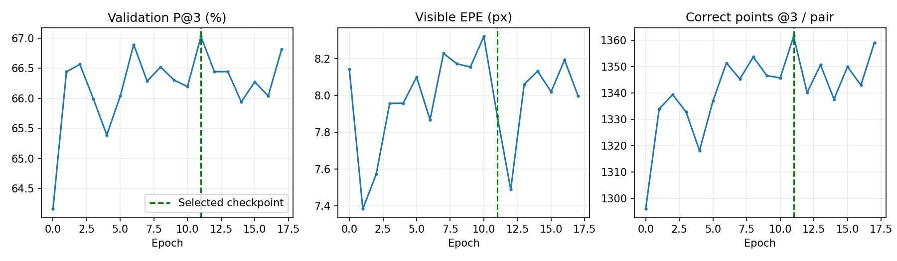

# 杭州D8/D2训练结果（关闭QRRU）

已完成17轮，最佳第11轮。254训练/64验证对，沿用清理后空间划分。
冻结DINO、MVT、原Flow及Matchability；更新VGG、D8/D2解码器和温度。继承旧下游第7轮权重，非随机重新训练。QRRU不调用、不参与损失或优化器。
最多30轮，AdamW 8e-5，余弦退火，累积4对；验证P@3连续6轮未提升至少0.1个百分点即早停。初始模型也参与最佳选择。
实际推理采用Flow局部D8 ±4格 → D2，最多2048对，不额外截断Matchability。训练标签沿用近似H及已有不确定区域损失。
**以下为杭州近似H参考一致性，不等同于人工标注的真实定位精度；该验证集用于早停，不是独立测试集。**

|指标|训练前|最佳轮|
|---|---:|---:|
|P@1 (%)|30.38|30.57|
|P@3 (%)|64.16|67.03|
|可见EPE (原图px)|8.14|7.89|
|输出点/对|2019.92|2031.25|
|正确点@3/对|1296.02|1361.52|

|分组|训练前P@3|最佳轮P@3|最佳轮同点Flow P@3|
|---|---:|---:|---:|
|G0|86.05%|84.63%|81.23%|
|G1|73.79%|78.37%|78.10%|
|G2|53.78%|59.59%|67.89%|
|G3|42.11%|44.98%|44.74%|

## 最佳权重复评

|数据|D8 P@3 前→后|D2 P@3 前→后|D2 EPE 前→后|训练后同点Flow P@3→D2 P@3|
|---|---:|---:|---:|---:|
|hangzhou|60.15% → 59.90%|64.16% → 67.03%|8.14 → 7.89|68.11% → 67.03%|
|synthetic|64.77% → 64.37%|98.90% → 99.32%|0.85 → 0.83|81.71% → 99.32%|

## 结论

本轮训练带来有限收益：杭州D2 P@3提高2.87个百分点，正确点约增加65对/图对；P@1基本持平，EPE仅小幅下降。合成精细定位没有退化。

杭州最终同点比较仍为Flow 68.11%、D2 67.03%，G2差距最明显（Flow 67.89%、D2 59.59%）；G0则相对训练前退化。不能据整体P@3上升认定细化已全面优于Flow。保持QRRU关闭，后续优先检查G2的D8父窗口选择、D2候选及近似H误差，再决定是否修改细化结构或监督，不继续盲目延长训练。

完整最佳权重保存在 `outputs/flow_d8_d2/training/best.pt`，未将大权重上传Git。逐轮指标和前后逐对统计保存在本报告目录。
