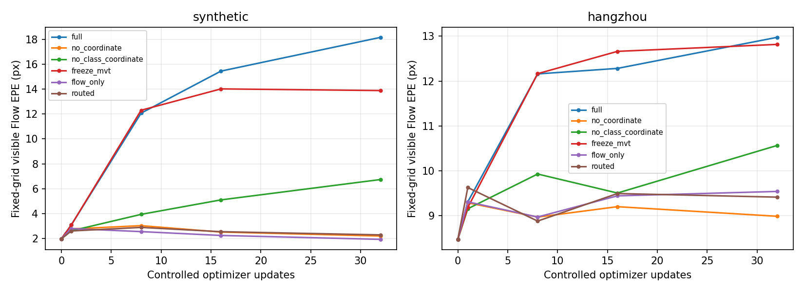

# 联合退化逐层排查：梯度、短步对照、窗口支持域

结论：主要退化来源是下游损失沿连续采样坐标直接更新Flow，尤其D2分类项梯度强且与Flow几何目标冲突；同时，固定4×4 D2目标窗口与强制输出全部16个子点造成支持域和选点问题。不是仅凭训练曲线推断。

诊断范围：每域用同一初始化，8个训练样本做逐项梯度审计；各干预用相同前32个训练样本、相同源查询随机种子、32次AdamW更新（每次1对，不复现长训的累积4与前三轮适配），在固定16对验证子集val[::4]评估。属于小规模因果定位，不是新训练效果验收，也不代表完整验证集水平。两域采用相同规则，不读取测试结果调参。

## 1. 单位与基础路径

用D8坐标线性场检查实际采样函数，原图坐标→归一化→D8采样的最大误差两域均为0。QRRU零初始化时final与p2一致（此前第0轮记录）。未发现此处倍率/align_corners错误，但不能据此排除所有实现问题。

## 2. 哪项梯度在推坏Flow

下面是8样本上梯度L2范数的均值，针对Flow目标坐标输出张量，不是不同参数量模块的梯度和。方向余弦以独立Flow可见EPE的梯度为参照；负值表示两者在输出坐标空间相冲突，不等于逐次AdamW更新的精确预测。

|域|损失项|Flow输出梯度范数均值|与降低Flow EPE目标的余弦均值|
|---|---|---:|---:|
|synthetic|flow|0.05254|0.808|
|synthetic|cls8|7.94902|-0.095|
|synthetic|geo8|1.33375|0.131|
|synthetic|cls2|25.71161|-0.106|
|synthetic|geo2|0.68033|0.062|
|synthetic|final|0.68033|0.062|
|hangzhou|flow|0.00770|0.513|
|hangzhou|cls8|0.33705|0.081|
|hangzhou|geo8|0.28320|0.209|
|hangzhou|cls2|1.97125|-0.118|
|hangzhou|geo2|0.02791|0.042|
|hangzhou|final|0.02791|0.042|

合成D2分类梯度均值约为Flow自身损失489倍，杭州约256倍。总损失对Flow输出梯度与Flow EPE梯度的平均余弦分别约−0.119、−0.067。说明“连通”不是“优化目标相容”。

实现机制：局部分类用于区分候选，但现在也通过grid_sample的采样位置修改Flow。改变窗口位置可以改变分类难度，并不等价于把Flow移向真实对应。分类标签是按当前移动网格生成后detach的，分类分支没有自动成为正确的坐标监督。几何项与分类项未经梯度比例校准直接相加，是本次设计的实质问题。

## 3. 对照更新确认

|干预|合成Flow EPE：32步后|杭州Flow EPE：32步后|
|---|---:|---:|
|更新前|1.977|8.476|
|完整旧联合|18.149|12.973|
|切断全部下游→Flow坐标梯度|2.201|8.990|
|只切断分类→坐标梯度|6.737|10.566|
|仅冻结MVT|13.879|12.816|
|仅Flow自身监督|1.934|9.543|
|分类不传坐标，定位坐标梯度乘0.01|2.294|9.416|

切断下游坐标回传、保留共享特征学习，显著减轻两域Flow退化；仅冻结MVT却仍严重退化，证明直接进入Flow头的坐标路径是关键因素。只去掉分类坐标梯度仍有退化，故不能宣称只有分类项有问题。只保留Flow自身监督时合成可维持/略改善，杭州仍小幅变差，说明域内监督/优化敏感性尚存在。
保留定位反传但将其进入Flow的梯度乘0.01，能抑制灾难退化，但合成2.294仍差于初始1.977，杭州9.416仍差于8.476；此干预只是机制证据，不是已经成功的修复，不启动长训。

## 4. D8中心错还是D2窗口不够

固定初始权重与相同源点，额外做仅用于诊断的H理想D8中心替换，绝不作为正常推理性能。统计真实对应是否处于目标4×4候选外包框；这是严格支持覆盖，不是P@3。

|域|实际D8中心：D2覆盖|理想D8中心：D2覆盖|同源点软解码P@3|同源点硬解码P@3|恢复细层互选后P@3 / 点数每对|
|---|---:|---:|---:|---:|---:|
|hangzhou|34.60%|69.68%|55.27%|53.92%|62.05% / 1439.2|
|synthetic|26.63%|26.72%|70.12%|69.38%|85.24% / 1132.9|

合成即使父中心准确仍仅26.72%子点真值在窗口内。源端6×6原图像素范围经缩放/透视后，在目标图中不必仍是6×6；固定目标窗口不能容纳全部16点。旧互选会淘汰许多没有合理对应的子点，而新实现每父窗口强制输出16点，训练却忽略窗口外真值，训练/输出约束不一致。
同一批源点上软解码略优于硬解码，当前证据不支持简单归罪于soft-argmax。恢复细层互选可提高精度，但输出点数减少（原为2048），不能把这种筛选后的精度提高当作同点定位改善，也不能声称正确点总数必然增加。

## 5. 覆盖下降形成反馈

已知长训合成D8覆盖由约97%降至12%，D2由23%降至4.5%。局部损失对覆盖内样本取均值，窗口移走后失败点失去局部约束，均值不能反映失败总量。这是已确认的监督盲区与反馈风险；本次没有单独修改覆盖惩罚做消融，不能把它确认为最初触发器。

## 处理结论

保留原有主线和权重。本次只新增诊断，不悄悄替换正式训练损失。下一版应先恢复合理候选筛选/支持范围，再把候选分类的特征学习与坐标优化分开：分类更新特征，坐标只接受明确定位监督；定位回传先校准梯度尺度，并以固定查询和覆盖统计约束验收。MVT更新影响与Flow输出头更新仍应分别验证。上面的0.01梯度路由尚未达到不退化要求，不值得直接跑长程。

本次共两域×6组短步对照，每组32次更新，外加逐项梯度与无训练窗口诊断。详细数据见本目录JSON；代码位于mhinet/v2/joint_single/diagnose.py、diagnose_windows.py。
