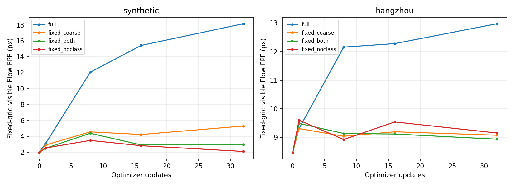

# 固定采样网格与D2支持范围：分步修正验证

继续上轮逐层诊断：本次只做短步干预和无训练窗口对照，没有启动长程训练，也没有替换主线默认推理。

## 第一步：停止通过移动特征采样位置优化分类

新增fixed_support.py。D8候选落在真实D8网格，窗口索引按Flow.detach()选择；连续Flow通过原强度3、sigma32px的高斯位置先验进入logits。D2候选落在真实D2网格，p8通过强度1、sigma4px的有界高斯先验进入细相关logits。软坐标及单次QRRU保留。此设计保证最终定位对Flow存在梯度，但不是对离散窗口选择求导。D2新增先验与固定支持域构成一个修正方案，不能把其效果归因于单一代码行。
fixed_noclass额外将分类项的坐标分支detach，只保留特征梯度；坐标回传只接受定位项。fixed_routed再将下游进入Flow位移的梯度乘0.01，前向值不变。各组仍使用4×4细目标窗，暂不混入扩大窗口的影响。

对照条件：每域同一初始化、相同32训练对/32次AdamW更新/源点随机种子、相同16对验证子集。没有重放旧长训前三轮适配，属于机制诊断。下面EPE均为固定D16源网格参考可见位置的原图像素误差。

|方案|合成EPE|杭州EPE|
|---|---:|---:|
|更新前|1.977|8.476|
|原移动网格联合|18.149|12.973|
|仅D8固定网格|5.297|9.080|
|D8+D2固定网格及位置先验|3.002|8.941|
|固定网格＋分类不回传坐标|2.112|9.157|
|上一组＋定位到Flow梯度×0.01|2.319|8.977|
|原路径完全阻断下游坐标回传|2.201|8.990|

固定网格加分类梯度隔离显著减轻合成退化（18.149→2.112px），但初始为1.977px，仍未通过不退化验收。杭州亦有残余退化。0.01缩放不在两个域同时最优，不能当成通用修复。固定网格各组的首步最终定位损失到Flow梯度均非零且有限，数值保存在对应JSON的final_to_flow_gradient_norm；不是靠完全切断后向获得稳定。

## 第二步：只改变目标D2支持范围

固定初始特征、Flow、同一批D8父中心和2048源点，在相同固定网格细解码/位置先验下仅比较4×4、8×8、12×12目标窗。源端仍为4×4，QRRU零初始化；不训练，不重新选择父窗口。以下全部源点指标先不做互选，保证比较的是同点定位。

|域|目标窗|参考可见真值覆盖率|全部2048源点P@3|正确点/对|可见EPE|
|---|---|---:|---:|---:|---:|
|hangzhou|4×4|39.45%|54.30%|1112.0|5.880|
|hangzhou|8×8|78.17%|57.57%|1179.1|5.823|
|hangzhou|12×12|90.19%|57.24%|1172.2|5.834|
|synthetic|4×4|26.61%|68.79%|1408.8|2.261|
|synthetic|8×8|92.66%|84.09%|1722.1|1.588|
|synthetic|12×12|99.24%|83.59%|1711.9|1.623|

合成4→8窗口：覆盖26.61%→92.66%，同点P@3 68.79%→84.09%，每对正确点1409→1722，证明原细窗口确实限制了匹配，不是只靠删点提高精度。12窗口进一步覆盖99.24%，但P@3略低于8窗口，说明更大窗口也增加干扰候选，不能单凭覆盖率选择无限增大。杭州收益较小，4→8 P@3 54.30%→57.57%。

恢复细层互选后8×8窗口：合成P@3 87.90%、1936点/对、1701正确点/对；杭州58.20%、1828点/对、1064正确点/对。互选提升精度但减少输出与正确点总数，需保留这项取舍，不能与全部2048点指标混称。

## 当前可采用与尚未通过的部分

- 已确认：D2目标支持域应与源端子点范围分开配置；8×8是本次开发子集上值得继续验证的候选，不是测试集最优结论。恢复互选时需同时报告数量与精度。
- 已确认：候选分类的特征梯度与坐标梯度应区分。固定特征采样支持域、通过几何先验连接坐标、再隔离分类的坐标分支，可以显著减轻崩溃并保留定位后向。
- 尚未通过：两域Flow完全不退化、修正版完整训练收敛、完整验证/测试收益。不能把32步干预结论升级为模型已修好。
- 主线未改动，未新增长程任务。下一步若训练修正版，应先冻结MVT/Flow验证8×8下游收益，再单独控制上游解冻；本轮不再次直接跑全部模块联合长训。

代码：fixed_support.py是独立候选实现；diagnose.py --fixed-only/--fixed-routed-only执行短步对照，diagnose_support.py执行窗口大小对照。counterfactuals中的after_original_moving_decoder不是新固定网格的推理指标，不能用于证明新解码器训练效果；本报告仅使用其固定网格Flow误差与独立无训练窗口数据。
