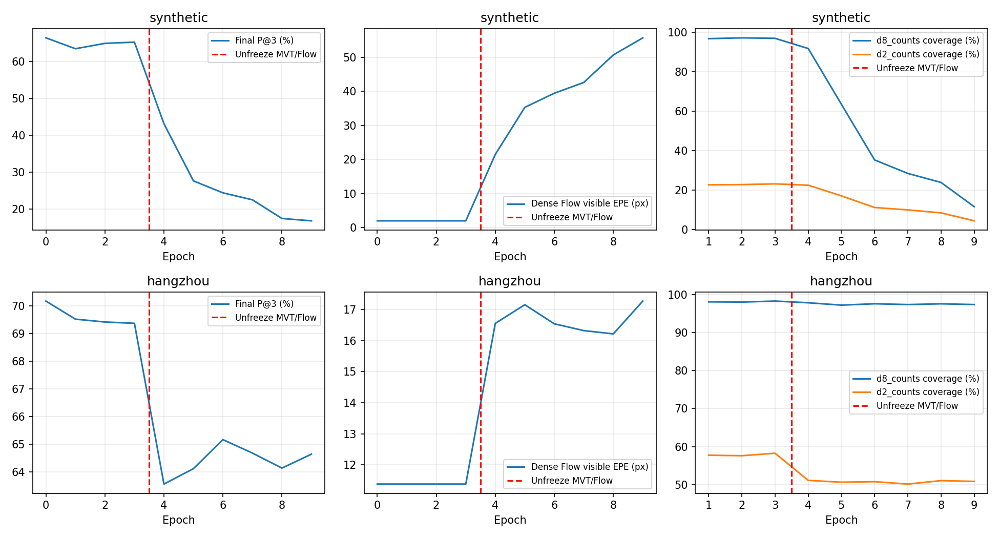

# 连续坐标联合训练：失败结果记录

**两组均第9轮早停，best_epoch=0。梯度连通检查通过，但没有训练精度收益；最佳模型测试实质上是初始化回退。未替换旧主线权重。**

本轮两个分域试验，非混合训练。每域254训练/64验证，前3轮冻结MVT/Flow，第4轮起解冻。新路径同时改变了窗口中心、坐标解码和选点规则，没有保留旧互选/去重，不能把新旧输出集合的差异单独归因于连续坐标。
下表是各自验证集。Flow EPE在固定1024个D16网格、参考可见位置统计，避免最终选点变化混淆Flow退化；最终P@3按全部2048输出统计。单位均为原图像素。

|训练域|初始最终P@3|第3轮|第4轮解冻后|第9轮|Flow EPE 初始→第9轮|
|---|---:|---:|---:|---:|---:|
|synthetic|66.34%|65.17%|43.12%|16.86%|1.98 → 55.75|
|hangzhou|70.17%|69.36%|63.56%|64.64%|11.39 → 17.27|

## 测试口径

两组选择的都是同一初始化，因此最佳测试指标相同：RGB_512新连续路径最终P@3为64.19%，杭州为59.24%。这是未训练模型结果，不是联合训练提升。相同初始权重下旧离散D2分别77.51%和58.02%；选点集合不同，该比较不是纯坐标解码消融。

## 可确认的问题

1. 退化主要在第4轮解冻MVT/Flow后出现：合成Flow EPE由1.98立即升至21.50px，第9轮55.75px；杭州由11.39升至16.55px，第9轮17.27px。两者都发生，不能只用近似H解释。
2. 合成训练局部覆盖急剧降低：D8约97%降至11.64%，D2约23%降至4.47%。局部损失只在窗口覆盖真值时计算，因此覆盖变少会使其只反映残存容易样本。第9轮final训练损失仍只有0.0266，不能据此判断整条链路变好。覆盖下降是观察事实；它是否是退化起因或反馈放大机制尚未隔离。
3. 解冻前连续路径适配也未超过初始化。这说明不只是联合更新的问题，新连续匹配和选点方式本身也需要单独验证。
4. 第9轮单次QRRU的净P@3变化仅约0.002个百分点（合成16.861%→16.862%；杭州64.636%→64.639%），不足以补救上游退化。

## 原因边界与下一步

当前仅证明梯度路径存在，没有证明梯度方向和各损失比例适合联合优化。下游分类/定位通过可移动窗口影响Flow，且监督样本覆盖会随预测变化；共享MVT更新也会改变Flow。数值损失大小不能替代逐项梯度方向与贡献分析，尚未证实是哪项主导破坏。
本轮设计未充分隔离连续解码、候选选择、MVT解冻和坐标梯度回传的影响，且对Flow能力保持的约束不足。保留原Flow→离散D8→D2主线，不部署本轮训练权重，不直接追加长训练。
若继续：先固定MVT与Flow，在相同候选/源点上验证连续解码；随后分别测试仅共享特征更新、仅下游坐标梯度回传及各辅助损失，记录对Flow的梯度贡献和窗口覆盖。确认无退化后才合并，不凭当前失败直接否定联合训练。

配置、全部逐轮指标、初始化及回退后逐对测试统计附在同目录JSON。last.pt保留第9轮实际训练权重；best.pt为第0轮，未覆盖原Flow或D8/D2权重。本次没有自动启动后续实验。
