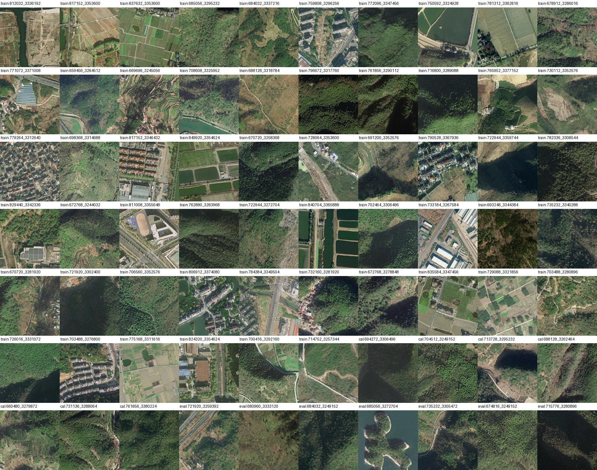
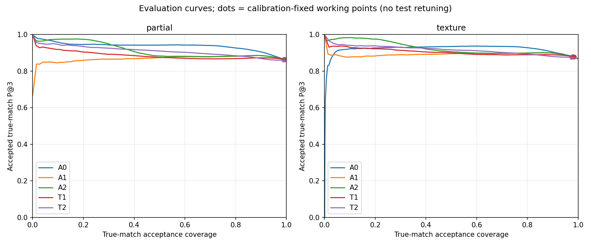
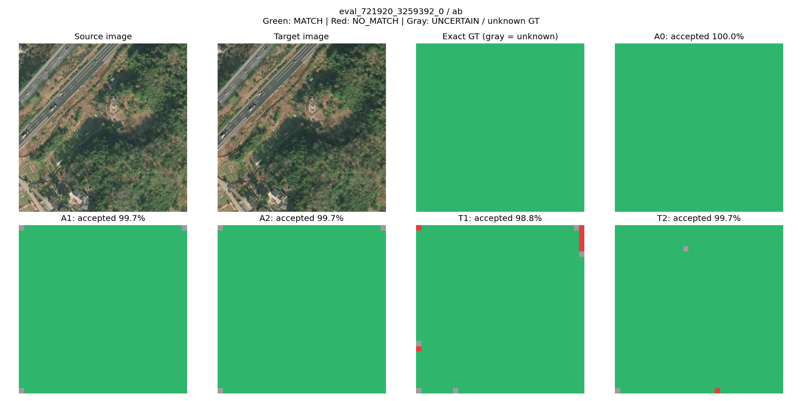
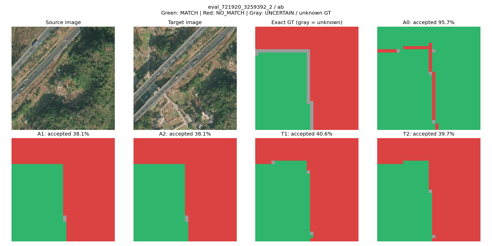
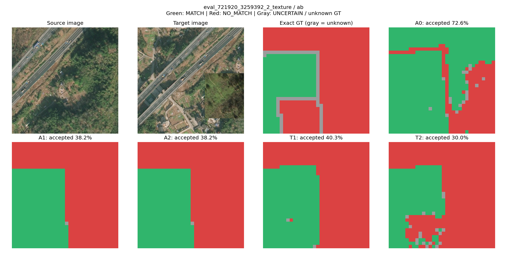
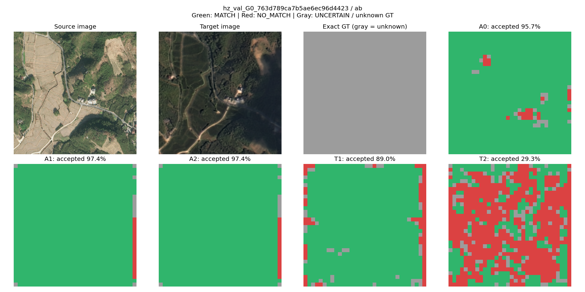
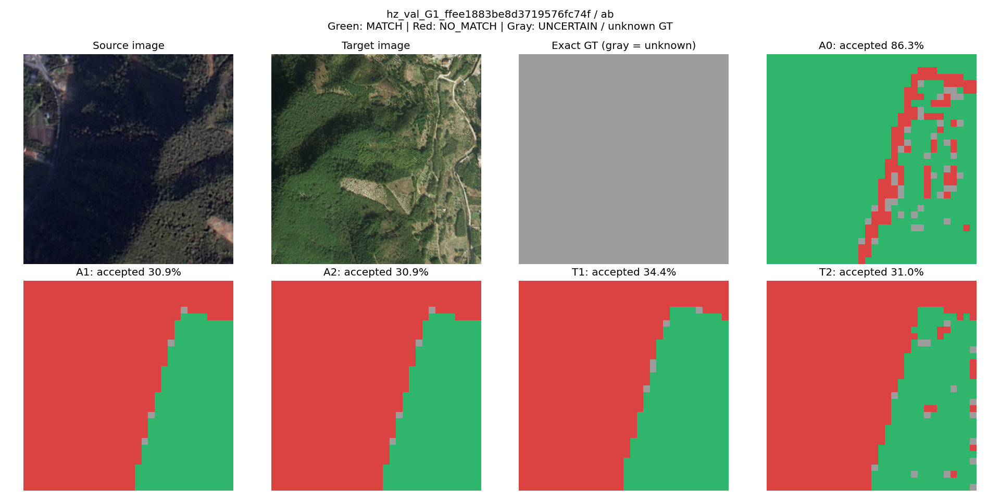
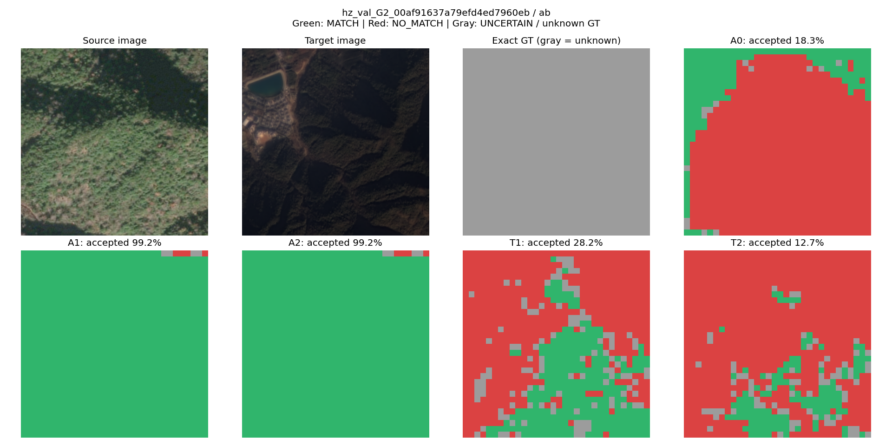
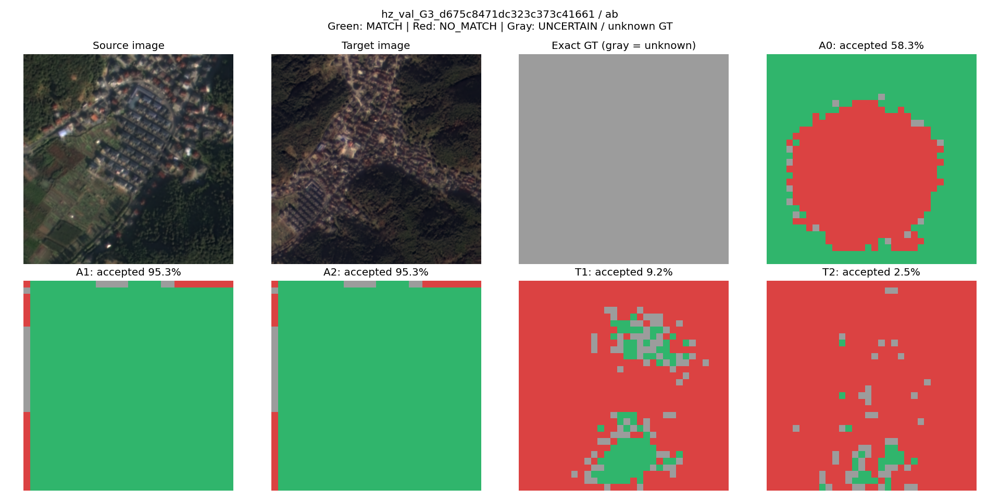

# PCF-01：杭州显式拒配验证报告

最终选择：**U0**。本轮新增拒配头未通过全部预设门槛，保留原 U0；不启动新的 Decoder 训练。

**技术结论：同源纹理覆盖监督能学到拒配能力，但不能直接当作杭州真实跨源影像的有效性输出。T2 在 G0/G3 上保留 63.32%/76.29% 的参考正确匹配；外观差异可能触发过度拒配。这里只有近似 H，因此这是参考定位证据，不是真实遮挡标签验证。**

## 协议与可复查证据

- 母图全部来自杭州天地图 RGB 原图，共 70 个地理块；训练/校准/评价为 [56, 7, 7]，裁剪前划分。无 GoogleEarth。
- 图对数量：{'train': 504, 'cal': 63, 'eval': 63, 'hz': 64}。合成数据双向评价；杭州跨源 G0–G3 只做 A→B 参考诊断。
- 逐像素实测重叠与目标档位平均绝对差：0.000362。没有将非重叠区域填黑。
- 校准、评价地理块均排除已记录 U0 杭州实验的使用块。训练母图可能来自旧训练块；不能据此宣称 DINO 预训练完全未见。
- 误差单位为 512 原图像素；所有方法共享同一份原始 U0 坐标。D8/D2/QRRU 不执行，原默认推理不修改。
- 校准阈值先固定再评价；真实有对应点被判 NO_MATCH 或 UNCERTAIN 均计误拒。UNKNOWN 真值不参与分类评价。
- 仅有 7 个独立评价地理块，本结论用于此次模块验收，不能当作广域遥感泛化结论。母图总览显示校准/评价以山地植被为主，城市建筑覆盖不足；训练含道路、村镇、农田、植被。
- 5 项规定数值测试通过，包含实际 U0 的冻结梯度及分类头一步更新前后坐标逐元素相等。

训练：每组 132,225 个参数，共 4 epoch、224 优化步，共同选择 epoch 1。T1/T2 初始化一致，U0 更新次数为 0。

共同早停的限制：T2 校准损失在第 1–4 epoch 持续下降，但 T1 上升导致共同指标变差。因此当前比较是预设共同预算/共同选点的结果，不是对 T2 可达到性能上限的估计；没有在看到独立评价后重训或调阈值。

## 同协议独立评价

A0=原 Dustbin；A1=原 Matchability；A2=两者固定组合；T1=仅几何部分重叠训练；T2=加入真实纹理覆盖训练。所有方法使用各自的校准集固定阈值。

| 方法 | 几何召回 | 几何误拒 | 纹理召回 | 纹理误拒 | 全重叠误拒 | 纹理 AUROC | 纹理 AUPRC |
|---|---:|---:|---:|---:|---:|---:|---:|
| A0 | 15.44% | 0.50% | 8.68% | 2.20% | 0.00% | 0.5770 | 0.3540 |
| A1 | 99.92% | 0.93% | 4.57% | 1.66% | 0.29% | 0.5337 | 0.2641 |
| A2 | 99.92% | 0.94% | 4.57% | 1.66% | 0.29% | 0.5541 | 0.2701 |
| T1 | 100.00% | 0.30% | 23.14% | 1.52% | 1.00% | 0.9295 | 0.7522 |
| T2 | 100.00% | 1.12% | 86.14% | 2.64% | 1.60% | 0.9849 | 0.8980 |

纹理子集的负例只包含真实纹理覆盖导致的确定无对应；其几何图外负例另行评价，避免混入容易负例抬高成绩。

| 方法 | 原始 P@3 | 原始 EPE | 原始 RMSE | 接受后 P@3 | 正确匹配保留 | R_correct@3 | 丢失正确点 |
|---|---:|---:|---:|---:|---:|---:|---:|
| A0 | 89.40% | 2.676 | 19.366 | 89.97% | 99.67% | 89.11% | 185 |
| A1 | 89.40% | 2.676 | 19.366 | 89.93% | 99.55% | 89.00% | 254 |
| A2 | 89.40% | 2.676 | 19.366 | 89.93% | 99.55% | 89.00% | 255 |
| T1 | 89.40% | 2.676 | 19.366 | 89.82% | 99.60% | 89.04% | 229 |
| T2 | 89.40% | 2.676 | 19.366 | 89.65% | 98.54% | 88.10% | 830 |

原始 P@1/3/5/10、EPE>32、各重叠率、三态比例及逐对指标见 [results.json](results.json) 和 [paired.csv](paired.csv)。原始精度相同来自冻结与相同坐标缓存，不代表新增头提升定位。

## 五个研究问题

### 1. 原 U0 Dustbin 为什么不能稳定拒配？

结构上它只有一个全局共享 logit，必须超过该查询所有空间候选才能成为 Top1；已有坐标解码器无论 Dustbin 多大都会输出坐标。该结构事实说明“有坐标”不等于“有对应”，但不是对失败原因的唯一因果证明。

校准纹理负例上的直接观测：

- p_dustbin：均值 0.000161307，P05/P50/P95=8.73343e-05/0.00015053/0.000270028。
- matchability：均值 0.988478，P05/P50/P95=0.99147/0.999852/0.999992。
- dustbin_logit_margin：均值 -7.74276，P05/P50/P95=-8.27862/-7.84953/-6.80817。
- Dustbin Top1 比例：0.00%。

这些分布和本轮基线结果共同判断可用拒配能力，不能只根据 Top1 为零断定完全没学习。

### 2. 显式头是否优于 Matchability？

- T1：positive_false_reject=未通过；texture_recall=未通过；texture_gain=未通过；geometry_retained=通过；original_coordinates_unchanged=通过；uncertain_bounded=通过。
- T2：positive_false_reject=未通过；texture_recall=通过；texture_gain=通过；geometry_retained=通过；original_coordinates_unchanged=通过；uncertain_bounded=通过。

### 3. 真实纹理监督是否有独立收益？

T2 相比 T1 的纹理负例召回变化为 +63.01 个百分点，纹理正例误拒变化为 +1.13 个百分点。两组结构、初始化、源图对数、优化步数和所选 epoch 一致。收益必须连同误拒和几何召回一起判断；不能把高分错误对应直接解释为无对应。

### 4. 丢失了多少真实正确匹配？

- A0：丢失 185 个 EPE≤3px 的真实匹配，正确匹配保留率 99.67%。
- A1：丢失 254 个 EPE≤3px 的真实匹配，正确匹配保留率 99.55%。
- A2：丢失 255 个 EPE≤3px 的真实匹配，正确匹配保留率 99.55%。
- T1：丢失 229 个 EPE≤3px 的真实匹配，正确匹配保留率 99.60%。
- T2：丢失 830 个 EPE≤3px 的真实匹配，正确匹配保留率 98.54%。

### 5. 是否继续真正的条件式解码？

没有候选通过全部门槛，证据不足以支持继续替换 Decoder。本轮结束，保留 U0。

## 杭州真实跨源诊断

这些图对只有近似 H，没有真实遮挡标签。下表“参考好点被拒”和“参考坏点被接受”是定位参考诊断，不是真实有无对应分类精度。

| 方法/组 | 原始参考 P@3 | 覆盖率 | 参考正确点保留率 | 高 Mat 且参考 EPE>32 点数 | 其中仍接受 |
|---|---:|---:|---:|---:|---:|
| A0/G0 | 74.50% | 99.72% | 99.98% | 0 | 0 |
| A0/G1 | 72.91% | 68.15% | 94.76% | 11 | 11 |
| A0/G2 | 73.44% | 37.82% | 49.73% | 725 | 248 |
| A0/G3 | 43.94% | 40.09% | 65.52% | 1239 | 625 |
| A1/G0 | 74.50% | 99.33% | 99.52% | 0 | 0 |
| A1/G1 | 72.91% | 58.47% | 97.98% | 11 | 11 |
| A1/G2 | 73.44% | 66.95% | 98.81% | 725 | 725 |
| A1/G3 | 43.94% | 50.54% | 97.76% | 1239 | 1239 |
| A2/G0 | 74.50% | 99.33% | 99.52% | 0 | 0 |
| A2/G1 | 72.91% | 58.47% | 97.98% | 11 | 11 |
| A2/G2 | 73.44% | 66.95% | 98.81% | 725 | 725 |
| A2/G3 | 43.94% | 50.54% | 97.76% | 1239 | 1239 |
| T1/G0 | 74.50% | 95.99% | 96.96% | 0 | 0 |
| T1/G1 | 72.91% | 60.23% | 98.88% | 11 | 9 |
| T1/G2 | 73.44% | 61.57% | 98.81% | 725 | 110 |
| T1/G3 | 43.94% | 39.14% | 99.04% | 1239 | 212 |
| T2/G0 | 74.50% | 62.19% | 63.32% | 0 | 0 |
| T2/G1 | 72.91% | 40.05% | 64.80% | 11 | 6 |
| T2/G2 | 73.44% | 42.50% | 73.01% | 725 | 21 |
| T2/G3 | 43.94% | 28.72% | 76.29% | 1239 | 64 |

高置信小 Top1–Top2 间隔和高熵只是多峰/歧义线索，不等同于经过人工确认的多个真实候选；相关数量见 JSON。

## 可视化

绿=接受对应，红=拒配，灰=不确定；GT 图中的灰表示未知标签。没有为拒配点发布箭头或坐标。合成示例按固定顺序取样；G0–G3 各取高置信大参考误差最多的一对，用来展示失效而非平均水平。

`eval_721920_3259392_0`（evaluation first fixed-order example, 40% overlap where applicable）

`eval_721920_3259392_2`（evaluation first fixed-order example, 40% overlap where applicable）

`eval_721920_3259392_2_texture`（evaluation first fixed-order example, 40% overlap where applicable）

`hz_val_G0_763d789ca7b5ae6ec96d4423`（diagnostic maximum count of high-Mat reference EPE>32, not representative random sample）

`hz_val_G1_ffee1883be8d3719576fc74f`（diagnostic maximum count of high-Mat reference EPE>32, not representative random sample）

`hz_val_G2_00af91637a79efd4ed7960eb`（diagnostic maximum count of high-Mat reference EPE>32, not representative random sample）

`hz_val_G3_d675c8471dc323c373c41661`（diagnostic maximum count of high-Mat reference EPE>32, not representative random sample）

## 文件

- `outputs/pcf01/queries_*.csv.gz`：逐查询坐标、精确标签/参考标签、各项分数、误差和来源。
- `outputs/pcf01/mother_selection.json`、`pairs.jsonl`、`data/`：地理划分、原图来源、裁剪参数及掩膜。
- `outputs/pcf01/T1.pt`、`T2.pt`：实验头权重（若阶段 A 触发训练）；未替换 U0。
- 本目录 JSON/CSV 和图片可随 Git 分享；大规模缓存及权重保留本机。
