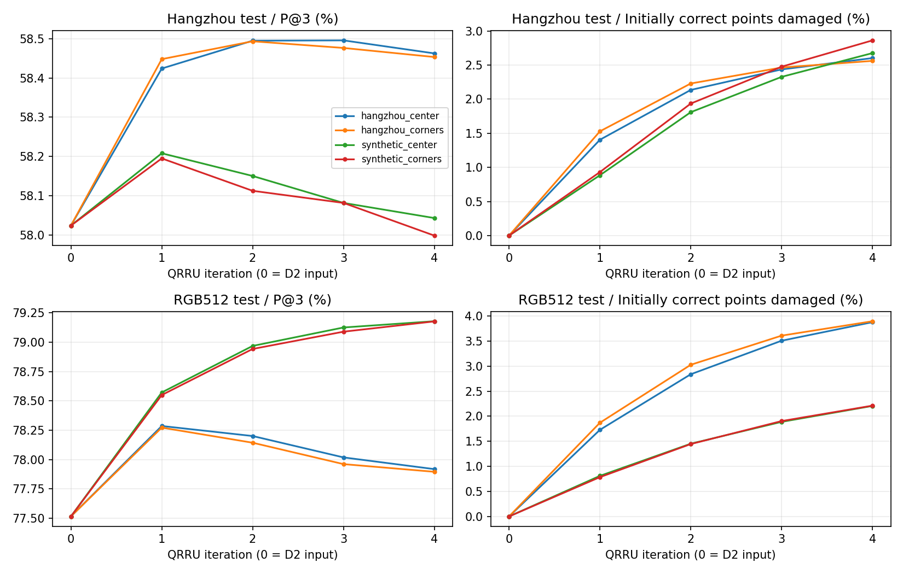

# QRRU中心与弱四角监督：四组结果

**结论：本轮四角权重0.1未带来可辨认的最终中心定位收益；部分四角参考误差下降，但未转化为匹配精度提升。**
四组均完成30轮，只训练全新同初始化QRRU，冻结原Flow及杭州D8/D2最佳第11轮权重。中心权重1；四角0或0.1。每域254训练/64验证/64测试，最佳权重仅由自身训练域验证集最终迭代P@3选择。杭州近似H带容忍范围；RGB_512精确H无死区。
**测试集口径：**杭州为既有hz_test按G0—G3各16对抽样；合成为RGB_512 test按其既有三个来源均衡抽样，不是上轮35对杭州同源合成数据。杭州也不是上轮64对验证集。这些测试不参与本轮选权重，但属于此前项目的既有数据池。
误差单位为512原图像素；P@3分母为全部输入匹配，参考不可见或修正出界点计错。四轮后不删点，不做拒配。改坏率=输入误差≤3px且修正后不再满足的点数/输入正确点数。

|训练组|最佳轮|自身验证P@3|杭州测试P@3|RGB_512测试P@3|
|---|---:|---:|---:|---:|
|杭州·中心|23|67.481%|58.463%|77.918%|
|杭州·中心＋四角|23|67.507%|58.454%|77.895%|
|合成·中心|29|79.200%|58.043%|79.179%|
|合成·中心＋四角|30|79.200%|57.998%|79.178%|

D2不启用QRRU的输入基线：杭州 **58.023%**，RGB_512 **77.515%**。

## Hangzhou test

|训练组|输入→第1→第2→第3→第4轮 P@3 (%)|输入→最终EPE|最终改坏率|最终救回率|最终四角EPE|
|---|---|---:|---:|---:|---:|
|杭州·中心|58.023 → 58.424 → 58.495 → 58.496 → 58.463|12.535 → 12.576|2.60%|4.65%|12.745|
|杭州·中心＋四角|58.023 → 58.448 → 58.494 → 58.477 → 58.454|12.535 → 12.575|2.56%|4.57%|12.652|
|合成·中心|58.023 → 58.208 → 58.150 → 58.081 → 58.043|12.535 → 12.594|2.68%|3.75%|12.767|
|合成·中心＋四角|58.023 → 58.195 → 58.112 → 58.081 → 57.998|12.535 → 12.600|2.86%|3.90%|12.879|
## RGB512 test

|训练组|输入→第1→第2→第3→第4轮 P@3 (%)|输入→最终EPE|最终改坏率|最终救回率|最终四角EPE|
|---|---|---:|---:|---:|---:|
|杭州·中心|77.515 → 78.286 → 78.201 → 78.018 → 77.918|2.211 → 2.198|3.88%|15.16%|2.845|
|杭州·中心＋四角|77.515 → 78.272 → 78.143 → 77.961 → 77.895|2.211 → 2.198|3.90%|15.12%|2.674|
|合成·中心|77.515 → 78.572 → 78.969 → 79.126 → 79.179|2.211 → 2.142|2.21%|15.01%|2.932|
|合成·中心＋四角|77.515 → 78.550 → 78.943 → 79.090 → 79.178|2.211 → 2.142|2.21%|15.02%|2.671|

## 判断与限制

- 杭州训练、杭州测试：中心监督58.463%，四角监督58.454%，差约−0.009个百分点；RGB训练、RGB测试：79.179%与79.178%，差约−0.002个百分点。单次种子实验不足以判断这么小的差异，不能宣称四角方案优于中心方案。
- 四角参考EPE确有改善：杭州模型在杭州测试12.745→12.652px，在RGB测试2.845→2.674px；RGB模型在RGB测试2.932→2.671px。但中心精度几乎不变，说明把四角拟合得更接近H并不自动改善最终中心。
- 杭州测试上，即使最佳组P@3略升，EPE仍从12.535升至约12.575px。部分正确点被修坏，不能只看P@3净收益。
- RGB训练模型在RGB测试从77.515%升至约79.179%，但迁移到杭州几乎无净收益。杭州训练模型在杭州仅提高约0.44个百分点。
- 多轮并非总更好：杭州训练模型在RGB测试第1轮最高，后续回落；RGB训练模型在杭州也在第1轮后回落。这是本轮观察，未用测试集重新选择迭代次数或阈值。
- 本轮仅比较四角权重0与0.1，不排除其他权重或结构可能有效。四角标签全部来自H，没有人工局部形变或遮挡真值。

**建议：当前不把四角监督作为默认改进，也不直接开启四轮QRRU。保留Flow→D8→D2主线；若继续研究QRRU，优先定位正确点被修坏和多轮漂移的原因，而不是扩大本轮四角权重搜索。**

各组逐轮验证指标、最佳权重测试逐对统计和配置已附在同目录JSON。权重在outputs/qrru_corners各组best.pt与last.pt，未上传大权重。
