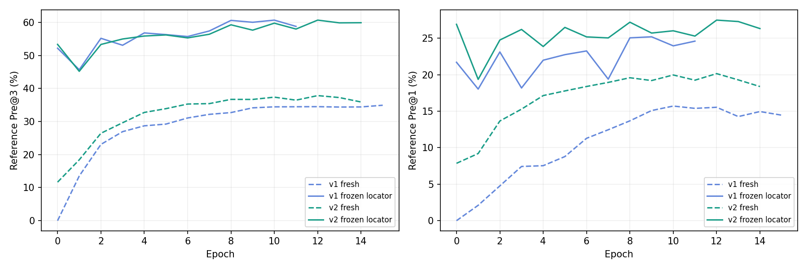

# 杭州小样本对照与清理后重训

所有指标均相对于近似地理 H；数据没有独立真实点或真实非刚性 Flow 标注。最佳轮次按各自验证 loss 选择。

| 实验 | 结束轮次 | 最佳轮次 | Pre@1 | Pre@3 | Flow EPE px |
|---|---:|---:|---:|---:|---:|
| v1_fresh | 15 | 9 | 15.09% | 34.14% | 100.45 |
| v2_fresh | 14 | 8 | 19.58% | 36.70% | 95.85 |
| v1_frozen | 11 | 5 | 22.74% | 56.30% | 35.93 |
| v2_frozen | 14 | 8 | 27.19% | 59.26% | 35.93 |
| v2_cleaned | 13 | 7 | 27.50% | 60.28% | 35.93 |

fresh：仅 DINO 预训练并冻结，其余活跃模块从头训练。frozen：额外加载并冻结同一份既有 MVT / MatchEmbedding 定位头，其余活跃模块从头训练。每轮最多 30 epoch，余弦退火、patience 6，512 输入、2048 匹配上限。

原小样本为 256 对训练、64 对验证。按用户清单从原数据集删除 636 对后，小样本命中 2 对训练，清理后实验使用剩余 254 对训练、64 对验证，不补样、不恢复旧杭州权重。清理前实验清单保留为历史记录，新启动入口使用 cleaned_v2.json。原数据和大体积权重不上传 Git。

对照显示保留已有定位能力明显改善小样本表现，不能将之前的低精度直接归因于 v2 或数据。初始化和冻结范围同时变化，尚不能独立归因。v1/v2 保留不同损失，不直接比较两者总 loss。

冻结定位分支的 Flow0 EPE 固定为 35.93 像素，G3 平均 98.87 像素，是主要困难组。QRRU 在固定扰动查询上的改善不等于真实预测候选上的稳定收益，后者仍需单独观察。

实验入口与配置：[comparisons/hangzhou_v1_control](../../comparisons/hangzhou_v1_control/README.md)。数据查看前端按用户要求已删除。
