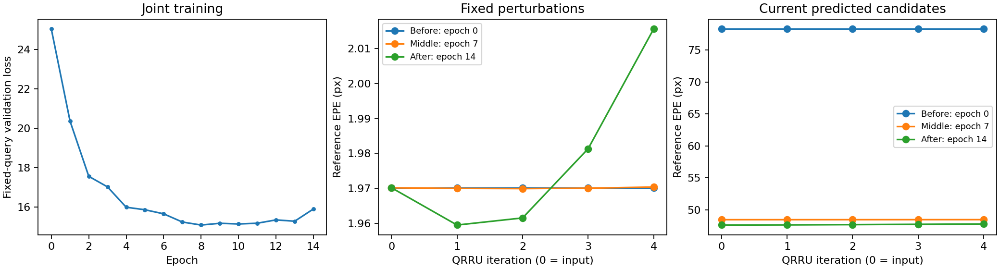

# 杭州小规模联合训练结果

实验于北京时间 2026 年 10 月 22 日 00:29 结束，第 14 轮触发早停，未扩大训练。代码位于 `codex/mhi-v2`，v1 不变。

## 数据与初始化

256 对训练、64 对验证，输入 512×512，输出匹配上限 2048。只加载并冻结原始 DINOv3，其他活跃模块重新初始化训练；没有加载旧实验权重。最多 30 轮，余弦退火，连续 6 轮验证损失不改善早停。

**数据没有真实稀疏标注点，也没有真实非刚性 Flow。所有监督目标来自近似地理 H。** 新增的稠密映射和稀疏点接口没有在此次杭州实验中使用。以下精度和误差均相对于近似地理参考，不是独立真实标注精度。

## 训练前、中、后

| 状态 | 轮数 | 验证损失 | 参考 Pre@1 | 参考 Pre@3 | 参考 Flow EPE（像素） |
|---|---:|---:|---:|---:|---:|
| 训练前 | 0 | 25.0466 | 7.8571% | 11.6587% | 176.504 |
| 中期 | 7 | 15.2405 | 18.9415% | 35.4156% | 97.142 |
| 结束 | 14 | 15.9051 | 18.3746% | 35.9077% | 92.524 |

最佳验证损失为 15.0882；结束状态不等同于最佳检查点。

## QRRU 结论

固定 8 对验证影像、相同参考查询和相同扰动，比较精修第 0 至第 4 轮。最终模型的固定查询 EPE 从精修前 1.9702 像素变为四轮后 2.0156 像素；第一轮为 1.9595 像素，后续迭代抵消了这点改善。实际预测候选也从精修前 47.6110 像素变为四轮后 47.7771 像素。

**本次未观察到 QRRU 四轮精修的有效收益，最终状态反而略有退化。** 整体参考一致性提升不能归因于 QRRU，更不能证明真实匹配精度提升。近似 H 加容差仍不足以提供可靠的像素级精修依据。

各训练阶段的实际预测候选集合会变化，不能把其跨阶段误差下降直接当作 QRRU 的学习收益。固定查询对照与实际候选分开记录。

详细数值：[QRRU 观察记录](evidence/hangzhou_fresh_qrru_summary.json)。完整日志与权重保留在本地 `outputs/mhi_v2/hangzhou_fresh_joint_20261021`，不将大体积权重上传到 Git。
